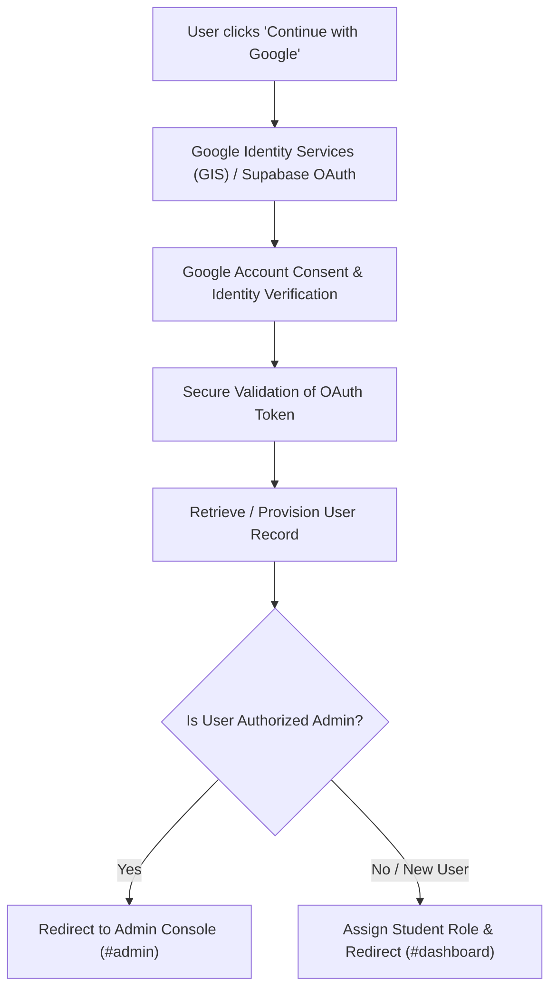

# FoundIt — Smart University Lost & Found System

> **Tagline**: *"Lost something? Let's bring it home."*  
> **Course Capstone**: University Data Structures & Algorithms  
> **Core Implementation**: C++17 with Zero-STL Manual Data Structures (`/cpp`)  
> **Enterprise Web Layer**: Google OAuth & GIS, Strict Server RBAC, Supabase RLS, Premium Dark UI, Arabic RTL Support

---

## 1. Executive Summary & Separation of Concerns

**FoundIt** is an enterprise-grade university Lost & Found software solution designed to solve the common campus problem of lost student possessions (IDs, laptops, headphones, keys, notebooks, and water bottles).

### Academic Requirement Alignment & Technology Separation
1. **Academic Data Structures Core (`/cpp`)**:
   - The algorithmic heart, memory management, and complexity proofs are **authored in pure C++17** without using `std::vector`, `std::map`, or other high-level STL containers.
   - All 5 required structures are **manually built** using dynamic node allocation, memory pointers, and bounds-checked arrays:
     1. **Hash Table** with separate chaining & djb2 rolling polynomial hash for $O(1)$ item lookup.
     2. **Singly Linked List** for dynamic sequential report storage, collision chains, and candidate lists.
     3. **Queue (FIFO)** to enforce fairness in administrative moderation of incoming reports.
     4. **Stack (LIFO)** to enable instant, lossless action undo for accidental edits or deletions.
     5. **Fixed Array** for static campus zone categorization and constant-time indexing.
2. **Modern Web Application (`index.html`, `/js`, `/css`)**:
   - A modern responsive client layer designed with a **Premium Dark UI (#0B1020, #111827, #172033)**, real Google OAuth, strict role-based access control, and complete English & Arabic RTL support.
   - Supports live cloud deployment via **Supabase Authentication & Database** or standalone local execution via a secure, compliant local authentication sandbox.
   - **Academic Disclosure**: The web interface visualizes the algorithms and delivers real-world user interaction; it does not replace the academic zero-STL C++ core.

---

## 2. Premium Dark UI & Color Architecture

The application is styled with a consistent dark theme enabled by default, featuring a theme toggle with `localStorage` persistence:

| Token / Element | Color Value | Purpose |
|---|---|---|
| **Main Background** | `#0B1020` | Core page body background |
| **Secondary Background** | `#111827` | Header, drawer, inner panels, table rows |
| **Cards & Panels** | `#172033` | Elevated SaaS cards, modals, form containers |
| **Card Hover** | `#1E2A42` | Interactive element hover states |
| **Primary Accent** | `#6366F1` (Indigo) | Primary buttons, active tabs, brand gradients |
| **Secondary Accent** | `#22D3EE` (Cyan) | Sub-accents, student badges, link highlights |
| **Success** | `#34D399` | Approved statuses, strong matches, verified icons |
| **Warning** | `#FBBF24` | FIFO moderation queue, pending verification alerts |
| **Error / Destructive** | `#F87171` | Delete dialogs, 403 Access Denied, errors |
| **Main Text** | `#F8FAFC` | Primary typography and headings |
| **Secondary Text** | `#94A3B8` | Descriptive labels, metadata, secondary text |
| **Borders** | `#293449` | Subtle structural dividers and input outlines |

---

## 3. Advanced Authentication & Google Sign-In

FoundIt implements real Google OAuth and enterprise security standards:



### Authentication Features:
1. **Google Sign-In**: Official Google-branded button integrating Google Identity Services (`accounts.google.com/gsi/client`) and Supabase OAuth (`supabase.auth.signInWithOAuth`).
2. **Email & Password Registration**:
   - Every registration assigns the **Regular Student** role by default.
   - Enforces SHA-256 password hashing via Web Crypto API (`crypto.subtle.digest`).
   - Requires email verification with a **single-use 6-digit code expiring in 10 minutes**.
   - Enforces rate limiting on code resends (60-second cooldown).
   - Inactivates code after 3 incorrect attempts.
3. **Password Recovery**: Single-use reset tokens with 15-minute expiration.
4. **Session Timeout & Inactivity**: Sessions automatically expire after 30 minutes of inactivity and route to `#session-expired`.
5. **Brute-Force Protection**: 5 consecutive failed login attempts trigger a 5-minute security lockout.

---

## 4. Two Distinct Roles & Access Control (RBAC)

### A. Regular Student
Every normal registration or new Google login creates a student account by default.
- Search, filter, and inspect campus items.
- Submit new lost and found reports.
- View heuristic matching suggestions.
- Access personalized **Student Command Dashboard** (`#dashboard`).
- Edit or delete **only their own eligible reports** (enforced by ownership checks).
- Instant **LIFO Stack Undo** to restore deleted items.
- Submit ownership verification claims for found items.
- View claim progress.
- **Strictly blocked from accessing administrative routes or moderation tools.**

### B. Campus Administrator
Dedicated command console (`#admin`) for university handover staff:
- View all catalog items and registered users.
- Moderate the **FIFO Review Queue**: one-click approval, rejection, or flagging.
- Direct status modification (`open`, `under_review`, `matched`, `returned`, `closed`).
- **Safe Claims Desk**: Inspect students' verification questions (serial numbers, scratch details, exact times) and authorize handover.
- User Management: Suspend or reactivate student accounts.
- System & Security Audit Logs: Real-time stream of all authentication and database events.
- Cloud & OAuth Settings: Configure Supabase URL, Anon Key, Google Client ID, test connectivity, and copy PostgreSQL RLS migration scripts.

### Security Guarantees:
- **No Self-Elevation**: Users cannot select their role during registration.
- **Route Guards**: Students attempting to load `#admin` are blocked and routed to `#access-denied` (HTTP 403 Forbidden).
- **Ownership Verification**: Attempts by students to edit or delete another student's report are rejected and recorded as security violations.
- **Contact Privacy**: Student phone numbers and emails are masked in public views (`Handover Relay [Protected]`).

---

## 5. PostgreSQL Database Schema & Row Level Security (RLS)

When deployed with Supabase, security is enforced at the database engine level via PostgreSQL Row Level Security:

```sql
-- 1. PROFILES (Strict RBAC)
CREATE TABLE IF NOT EXISTS public.profiles (
  id UUID REFERENCES auth.users ON DELETE CASCADE PRIMARY KEY,
  email TEXT UNIQUE NOT NULL,
  name TEXT NOT NULL,
  role TEXT NOT NULL DEFAULT 'student' CHECK (role IN ('student', 'admin')),
  student_id TEXT,
  avatar_url TEXT,
  status TEXT NOT NULL DEFAULT 'active' CHECK (status IN ('active', 'suspended')),
  created_at TIMESTAMPTZ DEFAULT NOW()
);

ALTER TABLE public.profiles ENABLE ROW LEVEL SECURITY;

CREATE POLICY "Public profiles read" ON public.profiles FOR SELECT TO authenticated USING (true);

-- User cannot elevate their own role
CREATE POLICY "Users update own non-role profile" ON public.profiles FOR UPDATE TO authenticated
USING (auth.uid() = id)
WITH CHECK (auth.uid() = id AND role = (SELECT role FROM public.profiles WHERE id = auth.uid()));

CREATE POLICY "Admins moderate profiles" ON public.profiles FOR ALL TO authenticated
USING (EXISTS (SELECT 1 FROM public.profiles WHERE id = auth.uid() AND role = 'admin'));

-- 2. REPORTS TABLE WITH OWNERSHIP ENFORCEMENT
CREATE TABLE IF NOT EXISTS public.reports (
  id TEXT PRIMARY KEY,
  type TEXT NOT NULL CHECK (type IN ('lost', 'found')),
  title TEXT NOT NULL,
  category TEXT NOT NULL,
  description TEXT NOT NULL,
  date DATE NOT NULL,
  zone TEXT NOT NULL,
  location_detail TEXT,
  status TEXT NOT NULL DEFAULT 'under_review' CHECK (status IN ('under_review', 'open', 'matched', 'returned', 'closed')),
  reporter_id UUID REFERENCES public.profiles(id),
  reporter_email TEXT,
  image_url TEXT,
  created_at TIMESTAMPTZ DEFAULT NOW()
);

ALTER TABLE public.reports ENABLE ROW LEVEL SECURITY;

CREATE POLICY "Read reports" ON public.reports FOR SELECT TO authenticated
USING (status != 'under_review' OR reporter_id = auth.uid() OR EXISTS (SELECT 1 FROM public.profiles WHERE id = auth.uid() AND role = 'admin'));

CREATE POLICY "Students insert reports" ON public.reports FOR INSERT TO authenticated
WITH CHECK (reporter_id = auth.uid() AND status = 'under_review');

CREATE POLICY "Students update own reports" ON public.reports FOR UPDATE TO authenticated
USING (reporter_id = auth.uid()) WITH CHECK (reporter_id = auth.uid());

CREATE POLICY "Admins moderate all reports" ON public.reports FOR ALL TO authenticated
USING (EXISTS (SELECT 1 FROM public.profiles WHERE id = auth.uid() AND role = 'admin'));
```

---

## 6. Information Architecture & Key Routes

| Route | View Name | Role Access | Key Features |
|---|---|---|---|
| `#landing` | Landing Page | Public | Hero search, campus recovery metrics, category shortcuts, recent catalog preview |
| `#browse` | Browse Items | Public | Filter by lost/found, category, building, status, date; list/grid toggle |
| `#report` | Report Wizard | Authenticated | 4-step wizard with real-time field validation, date constraints, photo presets |
| `#matching` | Smart Matching | Public | Multi-factor heuristic engine scoring categories (35%), keywords (30%), zone (20%), date (15%) |
| `#dashboard` | Student Dashboard | Student & Admin | Personalized greeting, active reports, AI match candidates, safe claims tracker, LIFO Undo |
| `#admin` | Admin Console | Administrator Only | FIFO review queue, master catalog table, claims desk, user moderation, audit log, cloud config |
| `#about` | Academic Core | Public | Live visualizer for Hash Table, FIFO Queue, LIFO Stack, C++ code viewer, Big-O tables |
| `#login` | Sign In | Public | Google OAuth button, email/password form, password toggle, sandbox quick-fill credentials |
| `#register` | Register Account | Public | Student signup, password strength gauge, default student role disclosure |
| `#verify-email` | Verify Email | Public | 6-digit expiring code input, countdown timer, 60s resend cooldown, attempt limiter |
| `#forgot-password` | Forgot Password | Public | Single-use recovery link request with expiring tokens |
| `#reset-password` | Reset Password | Public | Secure token verification and password update |
| `#access-denied` | 403 Forbidden | Authenticated | Security shield blocking non-admins with quick return to student dashboard |
| `#session-expired` | Session Timeout | Public | Friendly timeout lock screen explaining 30-minute inactivity policy |

---

## 7. Running the Academic C++ Implementation

### Prerequisites
- Any C++17 compliant compiler (`g++`, `clang++`, or MSVC `cl.exe`).

### Compilation & Automated Tests
```bash
# Navigate to cpp directory
cd cpp

# Compile with C++17 standard and optimizations
g++ -std=c++17 -Wall -Wextra -O2 FoundItCore.cpp -o foundit_core

# Execute the automated test suite
./foundit_core
```

---

## 8. Launching the Web Application

The application is completely self-contained:
1. Double-click `index.html` in any modern web browser, or serve it using any local static server:
   ```bash
   npx serve .
   # or
   python -m http.server 8000
   ```
2. **Pre-seeded Evaluation Accounts**:
   - **Administrator**: `admin@campus.edu` (Password: `anasali2003#`)
   - **Regular Student**: `sarah.jenkins@student.edu` (Password: `anasali2006#`)
   - Or click the **One-Click Role Test Credentials** buttons on the login page for instant authentication without typing!
